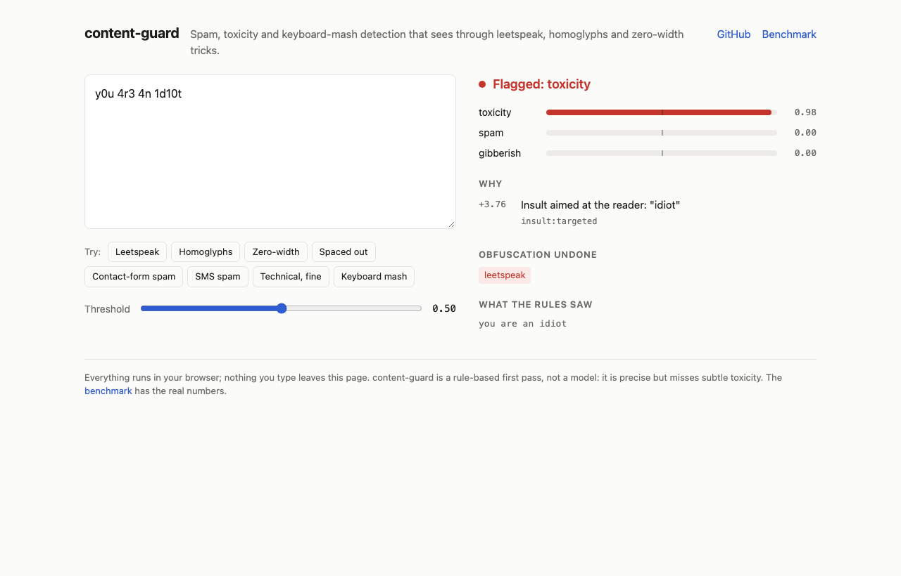

# content-guard

Small, dependency-free text moderation for JavaScript. It flags toxicity, spam and keyboard mashing, tells you exactly which rule fired, and is very hard to sneak past with `y0u 4r3 4n 1d10t`, Cyrillic look-alike letters, zero-width spaces or `f u c k`.



It's a fast, explainable first pass, not a language model. It's precise and it doesn't fall for obfuscation, but it misses toxicity that doesn't use toxic words. The [benchmark](#benchmark) has the real numbers, mediocre parts included.

## Install

```bash
npm install content-guard
```

Node 22+, or any browser, worker or edge runtime. ESM and CommonJS, types included, zero runtime dependencies. The bundle is 12.9 kB gzipped and the whole install is 147 kB (`npm run size`).

## Use it

```js
import { analyze } from 'content-guard' // or: const { analyze } = require('content-guard')

analyze('уоu аrе а l0s3r, k.y.s')
```

```js
{
  flagged: true,
  categories: ['toxicity'],
  scores: { toxicity: 0.979, spam: 0, gibberish: 0 },
  reasons: [
    { category: 'toxicity', rule: 'threat:self-harm', description: 'Encourages someone to kill or hurt themselves', match: 'kys', weight: 2.5 },
    { category: 'toxicity', rule: 'insult:targeted', description: 'Insult aimed at the reader: "loser"', match: 'loser', weight: 1.36 }
  ],
  obfuscation: ['homoglyphs', 'leetspeak', 'spacing'],
  technicalContext: false,
  normalized: 'you are a loser kys'
}
```

That input is Cyrillic letters pretending to be Latin, leetspeak and dotted letters, all in one message. Every one of them gets undone before matching, and the verdict tells you which tricks were used.

Contact forms were the original use case, so submissions work too:

```js
analyze({
  name: 'Mike',
  email: 'mike@mailinator.com',
  message: 'Dear website owner, we can get your site on the first page of Google with our SEO services.',
})
// flagged: spam, via spam:seo-outreach, spam:cold-outreach and spam:disposable-email
```

### Options

```js
import { createGuard } from 'content-guard'

const guard = createGuard({
  threshold: 0.5, // score at which a category is flagged; lower is stricter
  categories: ['toxicity', 'spam', 'gibberish'], // which ones to check
  contextAware: true, // soften borderline words in code reviews and tech talk
  blockTerms: ['frobnicate'], // extra words to flag (obfuscated spellings are caught too)
  allowTerms: ['damn', 'crap'], // built-in words your community is fine with
})

guard.analyze(text)
guard.isFlagged(text)
```

Build the guard once and reuse it. Everything is synchronous and side-effect free, so it's fine in a request handler, a worker or a Cloudflare/Vercel edge function.

There are no presets on purpose. The benchmark sweeps the threshold (0.3 / 0.5 / 0.7), and that one knob covers the whole precision/recall trade-off. Five named presets would just be five names for numbers.

### CLI

```bash
npx content-guard "y0u 4r3 4n 1d10t"
# FLAGGED (toxicity)  toxicity 0.98  spam 0.00  gibberish 0.00
#   +3.76 insult:targeted            Insult aimed at the reader: "idiot"
#   obfuscation: leetspeak

npx content-guard --lines --json < comments.txt   # one JSON verdict per line
npx content-guard --only spam --threshold 0.3 "FREE entry, txt WIN to 80086"
```

Exit code is `1` when anything was flagged, so it drops straight into scripts and git hooks.

## What it catches

| Trick | Example | What the rules see |
| --- | --- | --- |
| Leetspeak | `y0u 4r3 4n 1d10t` | `you are an idiot` |
| Homoglyphs (Cyrillic, Greek, 550+ look-alikes from Unicode's confusables table) | `уоu аrе а mоrоn` | `you are a moron` |
| Zero-width and bidi characters | `id​iot` (U+200B inside) | `idiot` |
| "Fancy font" generators | `𝔂𝓸𝓾 𝓪𝓻𝓮 𝓪𝓷 𝓲𝓭𝓲𝓸𝓽` | `you are an idiot` |
| Zalgo | `i̷̢̛d̴̨̛i̵o̶t̸` | `idiot` |
| Spacing and dots | `f u c k`, `k.y.s`, `c l a i m   y o u r   p r i z e` | `fuck`, `kys`, `claim your prize` |
| Stretching | `fuuuuuck` | `fuck` |
| Censoring | `f*cking` | `fucking` |
| Glued words | `killyourself` | `kill yourself` |

Decoding is dictionary-guided: a token is only rewritten when the result is a word the rules care about. So `h264`, `x86_64`, `Galaxy A55`, `v1.2.3`, `Scunthorpe`, `cocktail` and `assassin` come out the other side untouched, and real Russian or Greek text isn't mistaken for a homoglyph attack.

The other two halves:

- **Context.** Insults aimed at the reader ("you are pathetic") count for a lot more than opinions about things ("the turnout was pathetic"). Negation counts ("not a stupid question"). Text that reads as technical (code, file paths, CLI flags, domain vocabulary) gets untargeted borderline words softened, so `kill -9 the zombie process` or a code review calling `parse()` garbage doesn't get anyone banned. Slurs and threats are never softened.
- **Keyboard mashing.** `asdfghjkl` and `sdkjfh lkjsdf` are scored with an English letter-transition model (built from public-domain Gutenberg books) plus keyboard adjacency. `hahahaha`, `soooo` and `kubectl` are fine.

## Benchmark

Every number here comes from `npm run bench`, which downloads openly licensed public datasets (about 45 MB, cached and git-ignored), runs the library and the baselines, and writes [`bench/results/latest.md`](bench/results/latest.md). The lexicon weights were calibrated on the validation and dev splits only; these are the held-out test splits.

**Toxicity** on [Civil Comments](https://huggingface.co/datasets/google/civil_comments) (CC0, 97,320 test comments, 8% toxic). The last column is the share of 606 benign Stack Exchange questions the same classifier flags:

| System | Precision | Recall | F1 | Benign tech FPR |
| --- | ---: | ---: | ---: | ---: |
| **content-guard** | **0.638** | 0.452 | **0.529** | 1.5% |
| [obscenity](https://github.com/jo3-l/obscenity) (word list + anti-obfuscation) | 0.343 | 0.088 | 0.140 | 0.8% |
| [bad-words](https://github.com/web-mech/badwords) (word list) | 0.260 | 0.149 | 0.189 | 2.3% |
| Naive Bayes trained on the Civil Comments validation split | 0.419 | 0.319 | 0.362 | 16.2% |

**Spam** on the [UCI SMS Spam Collection](https://archive.ics.uci.edu/dataset/228/sms+spam+collection) (CC BY 4.0, 2,685 test messages):

| System | Precision | Recall | F1 | Benign tech FPR |
| --- | ---: | ---: | ---: | ---: |
| **content-guard** | **0.997** | 0.817 | 0.898 | 0.2% |
| Naive Bayes trained on the other half of the same dataset | 0.895 | **0.947** | **0.920** | 9.7% |

**Adversarial robustness** on hand-written seed messages run through 11 obfuscation transforms, using only the holdout seeds that were written after the normalizer was finished:

| | content-guard | obscenity | bad-words |
| --- | ---: | ---: | ---: |
| Obfuscated toxic messages caught | **97.3%** | 16.4% | 5.0% |
| Obfuscated harmless messages flagged | **0.0%** | 4.5% | 1.4% |
| Obfuscated spam caught | 86.4% | n/a | n/a |

**Speed:** about 5,800 messages per second on one core of a 2020 M1 MacBook Air (p50 113 µs, p99 620 µs, mean message length 294 characters), measured while five other agents were hammering the same laptop, so take it as a floor.

The full report has the threshold sweep, per-transform tables, a keyboard-mash sanity check and dataset checksums.

### What the numbers say

- **Use it as a precise first pass.** When it flags toxicity it's right about two times in three, and it almost never flags technical writing. On SMS spam it raised exactly one false alarm in 2,685 messages (while letting about one spam in five through).
- **It misses polite poison.** Recall on Civil Comments is 45%. A lot of what crowd raters call toxic is snark, contempt and political hostility with no toxic vocabulary at all. No word list will ever catch "people like you are the reason this country is failing". If you need that, run a model on whatever content-guard lets through (see below).
- **A model trained on your data will beat it on your data.** The forty-line Naive Bayes wins on SMS spam because it learns 2005 UK texting vocabulary ("ringtone", "txt", "150p"). That's the point, and also the problem: the same model flags 10–16% of ordinary Stack Exchange questions. content-guard has no training data to overfit to.
- **Obfuscation is where it earns its keep.** Word-list filters fall over the moment someone types `1d10t` or swaps in a Cyrillic `о`. This doesn't.
- **English only.** The lexicon, phrase rules and mash detector are all English. Other languages pass through without false positives in the tests, but they also aren't moderated.

### Escalating to a model

The scores are there so you can tier it: let content-guard settle the obvious cases in microseconds and send only the uncertain middle to something expensive.

```js
const verdict = guard.analyze(text)
if (verdict.flagged) return reject(verdict.reasons)
if (verdict.scores.toxicity > 0.15) return await yourToxicityModel(text) // e.g. a hosted moderation API
return accept()
```

content-guard doesn't ship a model, deliberately. It would add hundreds of megabytes to a package that's currently 13 kB.

### Compared with 0.3.1

Same data, from `npm run bench:legacy` ([`bench/results/legacy.md`](bench/results/legacy.md)). 0.3.x only had one `isSpam` flag, so everything here is scored on "flagged at all":

| | This rewrite | 0.3.1 (`new ContentGuard('moderate')`) |
| --- | ---: | ---: |
| Civil Comments F1 (4,000-comment sample) | 0.500 | 0.209 |
| SMS spam F1 | 0.822 | 0.039 |
| Benign tech text flagged | 1.7% | 9.2% |
| Obfuscated toxic messages caught (holdout) | 97.3% | 20.9% |
| Time per message | 0.22 ms | 2.43 ms |
| Install size | 1 package, 147 kB | 135 packages, 346 MB |

The old README claimed 91–94% accuracy for four "v4.5 variants". None of that was reproducible, so it's gone.

## Playground

[`docs/index.html`](docs/index.html) is a static page that runs the library in your browser: paste text and watch the verdict, the rules that fired and the tricks that were undone. Run it locally with `npm run demo:build && python3 -m http.server -d docs`, or serve the `docs/` folder with GitHub Pages.

## Versions

npm already has content-guard 1.0.0 through 4.7.1 from June 2025, all deprecated and none of them this code. Since npm never lets a version number be reused, the rewrite is **5.0.0** (currently `5.0.0-rc.0`). The [CHANGELOG](CHANGELOG.md) explains the whole saga and has a migration table for 0.3.x users.

## Development

```bash
npm install
npm test             # vitest: normalizer, detectors, adversarial corpus, API, CLI
npm run typecheck
npm run build        # dist/: ESM, CJS, .d.ts, CLI
npm run bench        # full benchmark on the test splits (~2 min, downloads data once)
npm run bench -- --split dev --errors   # tuning view: dev splits plus false positives/negatives
npm run size         # bundle and tarball size
npm run demo:build   # rebuild docs/content-guard.js
```

`scripts/term-stats.ts` prints each lexicon word's precision on the Civil Comments validation split, which is where the weights in `src/lexicon.ts` come from. `scripts/gen-confusables.ts` and `scripts/gen-bigrams.ts` regenerate the two data tables from their sources.

## License

MIT. The benchmark downloads Civil Comments (CC0), the UCI SMS Spam Collection (CC BY 4.0, Almeida and Gómez Hidalgo) and Stack Exchange posts (CC BY-SA) at run time; none of that data is redistributed here. The confusables table is derived from Unicode's [UTS #39 data](https://www.unicode.org/reports/tr39/) under the Unicode License v3.
